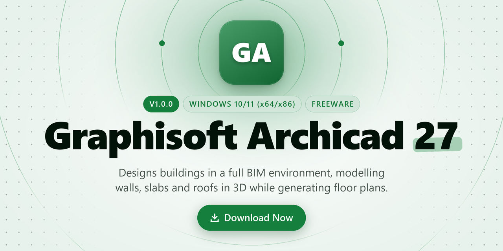

<h1 align="center">Graphisoft Archicad 27 - BIM Authoring Suite for Windows 10/11</h1>

<p align="center"><i>Graphisoft Archicad 27 is a full BIM authoring environment for architects and design teams on Windows 10 and 11. It models walls, slabs, roofs and openings in 3D while generating floor plans, sections, elevations and schedules from a single model. This page documents system requirements, configuration paths, shortcuts, CLI flags and known Windows issues.</i></p>

<p align="center">&nbsp;&nbsp;&nbsp;&nbsp;&nbsp;&nbsp;&nbsp;&nbsp;</p>

<p align="center"></p>

<p align="center">
  <a href="https://river-open-09.github.io/graphisoft-archicad-27/">
    <picture>
      <source media="(prefers-color-scheme: dark)" srcset="./assets/Click-dark.svg">
      
    </picture>
  </a>
</p>

<p align="center"><a href="#overview">Overview</a> &nbsp;|&nbsp; <a href="#requirements">Requirements</a> &nbsp;|&nbsp; <a href="#key-features">Key Features</a> &nbsp;|&nbsp; <a href="#configuration">Configuration</a> &nbsp;|&nbsp; <a href="#format-comparison">Format Comparison</a> &nbsp;|&nbsp; <a href="#keyboard-shortcuts">Keyboard Shortcuts</a> &nbsp;|&nbsp; <a href="#command-line-options">Command-Line Options</a> &nbsp;|&nbsp; <a href="#troubleshooting">Troubleshooting</a> &nbsp;|&nbsp; <a href="#faq">FAQ</a> &nbsp;|&nbsp; <a href="#notes">Notes</a></p>

## Overview

Archicad 27 is a desktop BIM application that keeps a single building information model and derives all 2D documentation from it. The paragraphs below describe what the build contains and who typically deploys it.

### What It Does

The application stores building elements as parametric BIM objects (walls, slabs, roofs, columns, zones, doors, windows) in a native `.pln` project. Plans, sections, elevations, 3D views and schedules are generated from the same model, so edits propagate automatically across all documentation views.

### Who It Is For

Architects, BIM coordinators and design offices running Windows workstations. Teams that need native IFC export, model-based quantity takeoff and multi-discipline coordination use Archicad 27 as the authoring hub, then exchange data with structural and MEP consultants via IFC or DWG.

### What Ships in the Build

The installer delivers the Archicad application, the BIMcloud/Teamwork client, the MEP Modeler add-on, the Parametric Profile Editor, the Library Part Maker and the IFC translator set. A separate installer is provided for the CodeMeter license runtime and for the Graphisoft Update utility.

## Requirements

| Spec | Minimum | Recommended |
|---|---|---|
| OS | Windows 10 64-bit (1909 or later) | Windows 11 64-bit (22H2 or later) |
| CPU | Intel Core i5 / AMD Ryzen 5, 4 cores | Intel Core i7 / AMD Ryzen 7, 8 cores or higher |
| RAM | 8 GB | 32 GB or more for large models |
| GPU / display | OpenGL 3.3, 1920x1080, 2 GB VRAM | OpenGL 4.5, 2560x1440 or 4K, 6 GB VRAM dedicated |
| Storage | 10 GB free for install, SSD | 40 GB free NVMe SSD for project and library cache |
| Project / teamwork | Local `.pln` only | BIMcloud or Teamwork server connection for shared models |

## Key Features

* **Single-model documentation** , generates floor plans, sections and schedules from the same BIM database.
* **Parametric BIM elements** , edits wall, slab and roof geometry once and propagates changes to all views.
* **IFC 4 export and import** , exchanges models with structural and MEP consultants through a certified IFC translator.
* **BIMcloud and Teamwork** , enables concurrent multi-user editing of a shared project with element-level reservation.
* **MEP Modeler add-on** , routes ducts, pipes and cabling with clash detection against the architectural model.
* **Schedule and quantity takeoff** , builds interactive element schedules linked back to model objects.
* **Parametric Profile Editor** , defines custom wall, slab and roof cross-sections for complex geometry.
* **Renovation and design options** , tracks existing, demolished and new status per element with variant filters.

## Configuration

| Path | Purpose |
|---|---|
| `%APPDATA%\GRAPHISOFT\Archicad 27\` | Per-user work environment, toolbars, schemes and saved views |
| `%LOCALAPPDATA%\GRAPHISOFT\Archicad 27\` | Local caches, preview thumbnails and temporary render files |
| `%PROGRAMDATA%\GRAPHISOFT\Archicad 27\` | Machine-wide defaults, library index and add-on registration |
| `%APPDATA%\GRAPHISOFT\Archicad 27\Work Environment\` | Exported work environment profiles (`.wep`) |
| `%PROGRAMDATA%\GRAPHISOFT\BIMcloud Client\` | BIMcloud client config, server cache and certificate store |
| `%PROGRAMDATA%\GRAPHISOFT\CodeMeter\` | CodeMeter license container and runtime settings |

| Setting | Default | Notes |
|---|---|---|
| Work Environment profile | Default Profile | Switch via Options > Work Environment > Profiles; export to `.wep`. |
| Automatic save / backup | Every 10 minutes | Adjust under Options > Work Environment > Data Safety; keep backups on a fast local disk. |
| Undo limit | 30 steps | Raise only if RAM allows; large models consume memory quickly. |
| GPU rendering | OpenGL, hardware acceleration on | Disable only if you hit display artifacts on virtualized GPUs. |
| IFC translator | Coordination View 2.0 | Select per-export translator under File > Interoperability > IFC. |
| Update channel | Stable | Managed by the Graphisoft Update utility; preview builds are opt-in. |
| Log level | Standard | Increase via the diagnostic tool when filing support tickets. |

## Format Comparison

| Format | Native to | Fidelity in Archicad 27 | File Size (typical) | When to Pick |
|---|---|---|---|---|
| PLN | Yes | Lossless, full BIM model | 50-400 MB | Single-user authoring and backups |
| PLA | Yes | Archive, read-mostly | 100-800 MB | Delivering a frozen project snapshot |
| IFC 4 | No (certified exporter) | Element and property fidelity, geometry tessellation | 30-250 MB | OpenBIM exchange with consultants |
| DWG / DXF | No (via translator) | 2D layouts and layers, limited 3D | 1-50 MB | Structured 2D handoff to CAD teams |
| SKP | No (import only) | Geometry import for reference models | 10-100 MB | Bringing SketchUp concept massing into the model |

## Keyboard Shortcuts

| Action | Shortcut |
|---|---|
| Wall tool | `W` |
| Slab tool | `S` |
| Roof tool | `Shift+R` |
| Door / window tool | `D` / `Shift+D` |
| Activate 3D view | `F5` |
| Activate plan view | `F4` |
| Fit in window | `Ctrl+Shift+F` (or double-click with middle mouse) |
| Open element settings | `Ctrl+T` |
| Group elements | `Ctrl+G` / ungroup `Ctrl+Shift+G` |
| Save project | `Ctrl+S` |
| Undo / redo | `Ctrl+Z` / `Ctrl+Shift+Z` |

## Command-Line Options

| Flag | Argument | Purpose |
|---|---|---|
| `-pr` | `<path.pln>` | Open a project file directly on launch |
| `-lib` | `<path>` | Append a library folder to the active load set |
| `-lic` | `server:<host>` | Point the license runtime at a CodeMeter network server |
| `-run` | `<script.gdl>` | Execute a GDL or add-on automation script at startup |
| `-noupdate` | none | Skip the Graphisoft Update check for this session |
| `-safe` | none | Start in Safe Mode without third-party add-ons |
| `-log` | `<path>` | Redirect diagnostic output to a file |
| `-batch` | `<jobfile>` | Run a headless export job (PLN to IFC or DWG) |

```bash
"C:\Program Files\Graphisoft\Archicad 27\Archicad.exe" -pr "D:\Projects\Tower.pln" -safe -log "%TEMP%\ac27.log"
```

| Exit Code | Meaning |
|---|---|
| 0 | Clean exit, no errors |
| 1 | General failure, check the log file |
| 2 | License not available or CodeMeter server unreachable |
| 3 | Project file could not be opened or is locked |
| 4 | Add-on or library load failure in Safe Mode fallback |

## Troubleshooting

### Project takes minutes to open

Opening a `.pln` file stalls on "Loading library" or "Rebuilding model" for several minutes on a fast SSD.

1. Open Options > Work Environment > Library Loading and remove unused library folders from the active set.
2. Delete the library index cache at `%LOCALAPPDATA%\GRAPHISOFT\Archicad 27\Library Cache` while Archicad is closed.
3. Confirm the project is stored on a local NVMe SSD, not a network share or OneDrive-synced folder.
4. Disable add-ons you do not need (MEP Modeler, Parametric Profile Editor) in Options > Add-On Manager and reopen.

### BIMcloud connection drops on join

The Teamwork client disconnects or times out while joining a shared project.

1. Verify the BIMcloud server hostname resolves and port 443/8443 is not blocked by Windows Defender Firewall.
2. Clear the BIMcloud Client cache under `%PROGRAMDATA%\GRAPHISOFT\BIMcloud Client\` after closing Archicad.
3. Check Windows clock sync (Settings > Time & Language) since certificates fail if the clock drifts beyond 5 minutes.
4. Re-import the server certificate if the logo shows a warning, then reconnect.

### License not found on startup

Archicad launches but shows "License not available" or cannot reach the CodeMeter container.

1. Confirm the CodeMeter runtime service is running (`services.msc`, "CodeMeter Runtime Server").
2. Open CodeMeter Control Center and verify the Archicad 27 product key is listed and shows a green status.
3. For network licenses, run `cmu31 -x` (CmdLine tool) or check the server address set via `-lic server:<host>`.
4. Restart the CodeMeter service after any driver or network change, then relaunch Archicad.

### 3D view crashes GPU driver

Archicad crashes or shows black viewports when switching to 3D, especially on hybrid or virtual GPUs.

1. Update the GPU driver to the latest vendor-signed release (Intel, NVIDIA or AMD) and reboot.
2. In Windows Settings > Display > Graphics, force Archicad to use the discrete GPU on multi-GPU laptops.
3. Set Options > Work Environment > 3D View > "Compatibility mode" if the crash persists with OpenGL 4.5 features.
4. If running inside a VM or Remote Desktop, disable hardware acceleration in 3D view settings.

## FAQ

### Does Archicad 27 run without an internet connection?

Yes. Archicad 27 authoring works fully offline with a local CodeMeter soft license, and local `.pln` projects open without any network access. Only BIMcloud/Teamwork collaboration and the Graphisoft Update check require connectivity.

### Can Archicad 27 and an older Archicad version run side by side?

Yes, but they install to separate program folders and share the CodeMeter runtime. Projects saved in Archicad 27 use the newer file schema and can be exported back to earlier versions via File > Save As with a "compatibility" translation, or better, via IFC.

### How do I move a project and its libraries to another Windows machine?

Use File > Save As and choose PLA (archive) to bundle the project with referenced libraries, then copy the `.pla` file. Alternatively, open the project, list the loaded libraries in Library Manager, and copy each library folder alongside the `.pln` before transferring.

## Notes

Graphisoft, Archicad and BIMcloud are trademarks or registered trademarks of Graphisoft SE. Windows is a trademark of Microsoft Corporation. This page documents Archicad 27 for Windows and is not affiliated with or endorsed by Graphisoft.